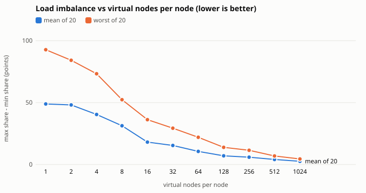
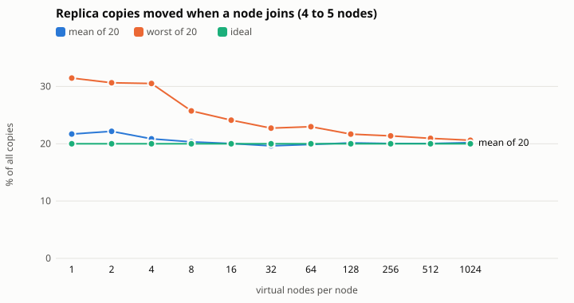
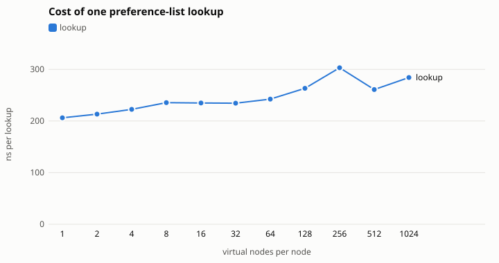

# How many virtual nodes? (ablation A1b)

## How 64 was originally chosen

Honestly: by reading experiment A1, which placed 100,000 keys on one 5-node ring at four vnode counts (1, 8, 64, 256) and showed 64 is "within about 10% of perfect balance". That is one placement (one set of node names), four points, and balance only. It did not measure data moved on join/leave, lookup cost, ring build cost, or how lucky that one placement was. So 64 was a reasonable pick from a coarse sweep, not an ablation. A1b is the ablation.

## Setup

MD5 ring (the default), 5 nodes, N=3. Vnodes per node swept 1, 2, 4, ..., 1024. For each count, 20 independent placements (different node names, so tokens land in different spots), 20,000 keys each. Measured: share of replica copies per node (every node should hold 60%), copies that must move when a 5th node joins (ideal 20%), cost of one `PreferenceList` lookup (fastest of 5 runs) and of building the ring. Run it with `go run ./cmd/archbench -only A1b`; full table in [results/architecture.md](../results/architecture.md).

## Results

| vnodes/node | tokens | mean CV | mean spread (pts) | worst spread of 20 | mean moved on join | worst moved | lookup | build |
|---|---|---|---|---|---|---|---|---|
| 1 | 5 | 0.314 | 48.9 | 92.7 | 21.7% | 31.5% | 398 ns | 7 µs |
| 4 | 20 | 0.242 | 40.4 | 73.3 | 20.9% | 30.5% | 527 ns | 13 µs |
| 8 | 40 | 0.191 | 31.3 | 52.3 | 20.3% | 25.7% | 564 ns | 20 µs |
| 16 | 80 | 0.112 | 18.1 | 36.2 | 20.0% | 24.1% | 666 ns | 35 µs |
| 32 | 160 | 0.095 | 15.4 | 29.4 | 19.6% | 22.7% | 659 ns | 60 µs |
| **64** | 320 | 0.064 | 10.6 | 22.0 | 19.9% | 23.0% | 692 ns | 118 µs |
| 128 | 640 | 0.043 | 7.1 | 13.9 | 20.1% | 21.7% | 761 ns | 241 µs |
| 256 | 1,280 | 0.035 | 5.9 | 11.5 | 20.0% | 21.4% | 905 ns | 554 µs |
| 512 | 2,560 | 0.025 | 4.1 | 6.9 | 20.0% | 20.9% | 903 ns | 1.2 ms |
| 1024 | 5,120 | 0.016 | 2.6 | 4.5 | 20.2% | 20.6% | 952 ns | 2.5 ms |

(Spread = most-loaded minus least-loaded node's share, in points; 10 means e.g. 55% to 65%.)

## What it shows

* **Balance improves roughly as 1/√vnodes.** Spread falls from 49 points (1 vnode) to 10.6 (64) to 5.9 (256) to 2.6 (1024). Each 4x in vnodes about halves the imbalance. There is no sharp knee, only diminishing returns.
* **64 is not placement-proof.** On average the busiest node holds about 5 points more than ideal, but the worst of 20 placements has a 22-point spread (for example 49% to 71%). Going to 256 cuts that worst case to 11.5.
* **Data moved on a join is about 20% for every count.** Consistent hashing already moves the minimum on average, so vnodes do not change the mean. What they change is the worst case: 31.5% at 1 vnode, 23% at 64, 21% at 256.
* **Cost is small in this simulation.** A lookup grows from about 0.4 to 0.95 µs, while one simulated network hop is about 400 µs. Building the ring takes 0.1 ms at 64 and 0.55 ms at 256, once at startup.

## Verdict

64 is defensible but not optimal on this evidence. If balance is the goal, 128 or 256 is better and costs nothing measurable here. What this simulation does not model, and what limits vnode counts in a real system, is per-vnode overhead: membership metadata, one Merkle tree or handoff range per vnode, and more neighbours to stream from during recovery. I did not change the default; switching `VNodes` in `DefaultConfig` is a one-line change if you want it (A1 and every other experiment would then need re-running).
