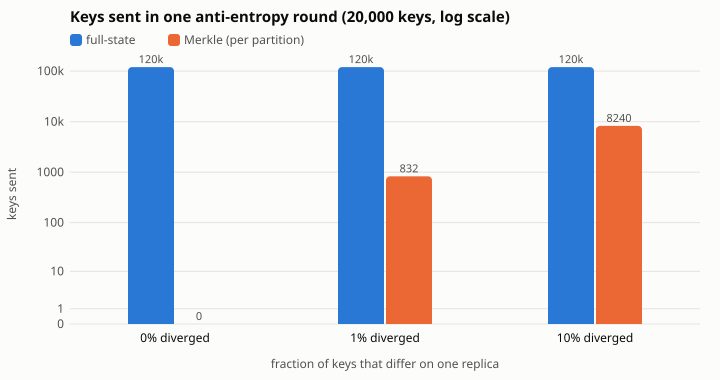
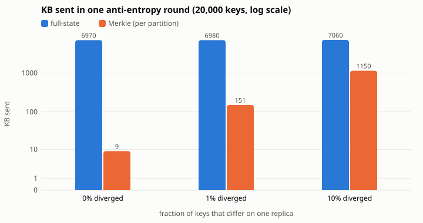
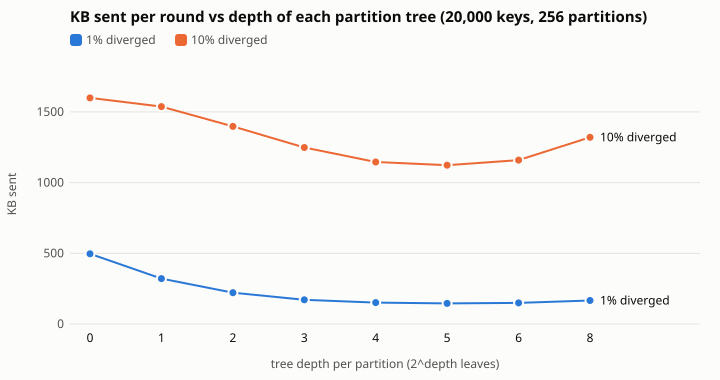
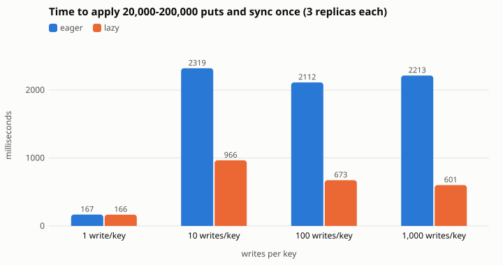
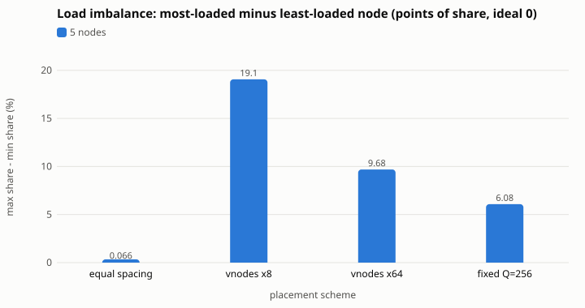
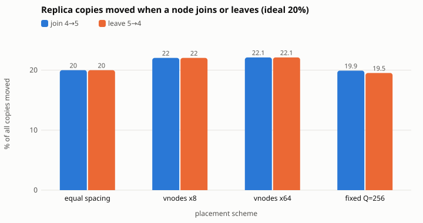

# Merkle anti-entropy and ring placement: what was built and why

Three design questions, three branches, one benchmark each. All numbers come from `go run ./cmd/archbench` (experiments A6, A7, A8; tables and charts in [results/architecture.md](../../results/architecture.md) and `results/*.svg`). The simulation runs in one process, so compare numbers with each other, not with a real deployment.

| Branch | Question | Added code (non-comment, non-blank lines in `store/`) |
|---|---|---|
| `main` | baseline: full-state anti-entropy, random vnodes | 1,151 |
| `merkle-anti-entropy` | replace full-state sync with Merkle trees, updated eagerly on every put | +305 |
| `merkle-lazy` (on the branch above) | rehash dirty keys only just before a sync | +17 more |
| `fixed-partitions` (on `merkle-anti-entropy`) | Q fixed equal partitions instead of random vnodes | +54 more |
| `merkle-experiments` | all three merged, for the combined benchmark run | 1,510 total |

Nothing is merged into `main`.

## D-M1. Why Merkle trees instead of a full-state exchange (A6)

Anti-entropy exists to find the few keys two replicas disagree on. A full-state exchange sends *every* shared key whether or not it differs.

```
full-state:   a ──[all 8,000 shared keys + versions]──▶ b
              a ◀──[all 8,000 shared keys + versions]── b

Merkle:       a ──[root hash]──▶ b          equal?  done (8 bytes)
              a ──[children]───▶ b          differ: descend only into
              ...                           the subtrees that differ
              a ──[keys under differing leaves]──▶ b
```

Setup: 20,000 keys, 3 replicas identical, then a fraction of keys gets a newer version on one replica. One round over all 10 node pairs.

| divergence | full-state keys / KB sent | Merkle keys / KB sent | traffic saved |
|---|---|---|---|
| 0% | 120,000 / 6,966 | 0 / 0.1 | 99.998% of bytes |
| 1% | 120,000 / 6,976 | 832 / 236 | 97% of bytes, 99.3% of keys |
| 10% | 120,000 / 7,061 | 8,240 / 1,428 | 80% of bytes, 93% of keys |

 

Full-state cost does not depend on how much differs; Merkle cost grows with the differences. The cost Merkle adds is round trips: one per tree level (13 per pair at depth 10, versus 1). In this simulation, with 0.4 ms hops and pairs run one after another, that makes a 1% or 10% round *slower in wall-clock time* (about 510-600 ms against 410-500 ms), while an already-in-sync round is 10x faster (38 ms). On a real network, where bandwidth is the scarce thing, the byte savings are the point; if round trips were costly the tree could be walked several levels per request, which this code does not do.

**Tree depth.** Deeper trees send fewer false-positive keys but more hashes. At 1% divergence, KB sent per round falls from 968 (depth 4) to 236 (depth 10) to 167 (depth 12), then flattens (166 at depth 14). Default is depth 10; depth 12 is slightly cheaper at 10% divergence (1,183 vs 1,428 KB) at the price of 20 more round trips.



## D-M2. Why lazy tree maintenance wins on writes, ties on cold data (A7)

Eager: every put hashes the key and rehashes ~10 tree levels for each of 2 peers. Lazy: a put records the key in a dirty set; the first sync rehashes each dirty key once.

| workload (200k puts max) | eager total | lazy total | per put, eager / lazy |
|---|---|---|---|
| each key written once | 167 ms | 166 ms | 8.4 / 2.4 µs |
| 10 writes per key | 2,319 ms | 966 ms | 11.6 / 4.1 µs |
| 100 writes per key | 2,112 ms | 673 ms | 10.6 / 3.3 µs |
| 1,000 writes per key | 2,213 ms | 601 ms | 11.1 / 3.0 µs |



Lazy puts are about 3x cheaper because repeated writes to one key are hashed once. Writing every key exactly once is a tie: the same hashing work just moves into the first sync (118 ms for 20,000 keys). The trade-off to know about: that flush runs under the node lock, so the first sync after a long quiet-then-busy period pauses the node for as long as the backlog takes (about 6 µs per dirty key here). Eager keeps every sync cheap and every put costlier. Both variants pass the same convergence tests and produce identical trees (checked against trees rebuilt from scratch).

## D-M3. Why fixed equal partitions (A8)

Compared on 100,000 keys, N=3, with the 5-node ring:

| scheme | min / max node share (ideal 60%) | copies moved on join 4→5 (ideal 20%) | leave 5→4 |
|---|---|---|---|
| equal spacing, 1 piece per node | 60.0 / 60.0 | 20.0% | 20.0% |
| random vnodes ×8 | 50.0 / 69.1 | 22.0% | 22.0% |
| random vnodes ×64 (current) | 56.7 / 66.3 | 22.1% | 22.1% |
| fixed partitions, Q=256 | 59.8 / 60.8 | 19.9% | 19.9% |

 

* **Balance:** fixed partitions are within 1 point of perfect; 64 random vnodes leave a 10-point spread, because random token positions are uneven.
* **Movement:** a join moves the theoretical minimum with fixed partitions (19.9% against 20%); random vnodes move about 10% more than needed.
* **Equal spacing** with one piece per node is perfectly balanced at a fixed N, but it must be recomputed from scratch for the new node count and so reshuffles which node is *first* replica for 34.9% of keys (fixed partitions: 19.9%, because only the new node's partitions change owner). It also has no spare pieces to hand around when node counts change.

A correction to the chat estimate: that "equal spacing moves about 50% of keys on a join" does not hold with N=3 replication here. Measured in replica copies, equal spacing moves 20%, the minimum; what it loses is stable first-replica ownership (34.9%), and it cannot rebalance in small steps.

Cost: `NewFixedRing`, `WithNode`, `WithoutNode` and `Config.Partitions` are about 54 code lines. The first version of `WithNode` gave the joiner *adjacent* partitions and was badly skewed (21%-80% shares); spacing them out fixed it, and `TestFixedRingJoinAndLeave` pins the behaviour.

**Not done:** one Merkle tree per fixed partition (so trees never need rebuilding when membership changes). The Merkle code keeps one tree per peer; after a join the trees for the changed peers would be rebuilt lazily from `data`. Per-partition trees are the natural next step, and A8 shows the partition boundaries they would hang off are stable.

## Proof that it works

`store/antientropy_test.go` and `store/ring_test.go`, run with `go test -race ./...`:

1. **`TestMerkleSyncMatchesFullStateSync`** (randomized, 25 seeds × eager and lazy). Each seed builds 300 keys whose replicas diverge by a random write history (coordinator picks, partial replication, stale contexts, concurrent siblings). One full-state round on a copy and one Merkle round must leave *identical* sibling sets, equal to the merge of everything written. The generator itself asserts no write is lost. A second round must send 0 keys. Trees must equal trees rebuilt from the data.
2. **`TestMerkleRepairsPartition`**: clients write through both sides of a partition (sloppy quorum, hinted handoff off), heal, run Merkle rounds only; every replica converges and every acknowledged write is on all three replicas.
3. **`TestMerkleOnFixedRing`** and **`TestFixedRingJoinAndLeave`**: the same convergence on the fixed ring; a join only moves partitions to the new node, and a leave leaves other partitions alone.

Sanity check of the tests themselves: removing the "want these keys" step of the leaf exchange, or dropping the old hash from the XOR update, made the convergence tests fail.

A flaky failure seen while building this was the test's 20 ms replica timeout firing under `-race`; test exchanges now use 5 s and fail on any sync error. Five consecutive runs were clean.
