# Ablations

Each experiment changes one design choice and reports mean (min-max) over 3 runs of 2s. Regenerate with `go run ./cmd/bench -ablate`.

## X1. How much does one run vary?

E1 workload (32 keys, 16 readers), each cell run 3 times with different latency seeds. Cells are mean (min-max). A difference smaller than the range is not a measured difference.

| R,W | stale reads % | get p99 ms | put p99 ms |
|---|---|---|---|
| 1,1 | 26.2 (26.1-26.4) | 5.1 (5.0-5.2) | 4.6 (4.4-4.7) |
| 1,2 | 0.3 (0.3-0.3) | 3.9 (3.7-4.0) | 8.3 (8.0-8.6) |
| 2,1 | 1.0 (1.0-1.0) | 8.5 (8.2-9.0) | 3.9 (3.7-4.1) |
| 2,2 | 0.0 (0.0-0.0) | 8.2 (8.1-8.4) | 8.3 (8.1-8.7) |

Read repair on vs off at R=W=1 (the claim in D13 that it barely changes staleness):

| read repair | stale reads % |
|---|---|
| true | 26.2 (26.0-26.4) |
| false | 26.1 (26.0-26.1) |

Verdict: the ranges overlap, so there is no measurable effect of read repair on staleness.

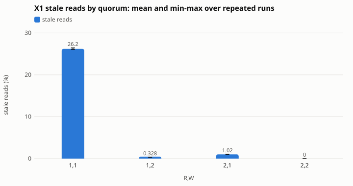

## X2. Sensitivity to the latency model

Every latency, staleness and timeout number depends on the simulated network. Same E1 workload under three models (replica hop base + exponential jitter, 3% of messages hit a slow path). Mean (min-max) of 3 runs.

| model | R,W | stale reads % | get p99 ms | put p99 ms | put failures % (20ms timeout) |
|---|---|---|---|---|---|
| LAN (0.1ms hop) | 1,1 | 8.3 (7.7-8.8) | 3.4 (3.3-3.5) | 5.5 (5.0-6.3) | 0.0 (0.0-0.0) |
| LAN (0.1ms hop) | 1,2 | 0.4 (0.4-0.4) | 3.3 (3.3-3.4) | 4.5 (4.4-4.5) | 0.0 (0.0-0.0) |
| LAN (0.1ms hop) | 2,2 | 0.0 (0.0-0.0) | 4.0 (4.0-4.1) | 4.0 (4.0-4.1) | 0.0 (0.0-0.0) |
| default (0.4ms hop) | 1,1 | 25.8 (25.7-25.9) | 5.6 (5.4-5.7) | 5.0 (4.8-5.2) | 0.0 (0.0-0.0) |
| default (0.4ms hop) | 1,2 | 0.3 (0.3-0.4) | 4.1 (3.9-4.4) | 8.6 (8.1-9.3) | 0.0 (0.0-0.1) |
| default (0.4ms hop) | 2,2 | 0.0 (0.0-0.0) | 8.1 (7.8-8.6) | 8.2 (8.0-8.6) | 0.0 (0.0-0.0) |
| cross-region (5ms hop) | 1,1 | 40.7 (40.1-41.0) | 7.1 (6.6-7.6) | 6.7 (6.4-7.0) | 0.0 (0.0-0.0) |
| cross-region (5ms hop) | 1,2 | 0.5 (0.4-0.6) | 6.1 (5.9-6.3) | 24.9 (24.7-25.1) | 23.0 (22.7-23.6) |
| cross-region (5ms hop) | 2,2 | 0.0 (0.0-0.0) | 24.5 (24.4-24.7) | 24.4 (24.3-24.6) | 23.0 (22.7-23.1) |

Replica timeout vs spurious put failures on a healthy cluster (R=W=2), same three models:

| model | timeout | put failures % |
|---|---|---|
| LAN (0.1ms hop) | 5ms | 0.0 (0.0-0.1) |
| LAN (0.1ms hop) | 20ms | 0.0 (0.0-0.0) |
| LAN (0.1ms hop) | 100ms | 0.0 (0.0-0.0) |
| default (0.4ms hop) | 5ms | 2.0 (1.8-2.2) |
| default (0.4ms hop) | 20ms | 0.0 (0.0-0.0) |
| default (0.4ms hop) | 100ms | 0.0 (0.0-0.0) |
| cross-region (5ms hop) | 5ms | 100.0 (100.0-100.0) |
| cross-region (5ms hop) | 20ms | 23.0 (22.6-23.3) |
| cross-region (5ms hop) | 100ms | 0.0 (0.0-0.0) |

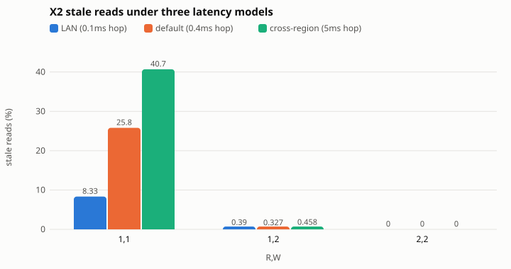
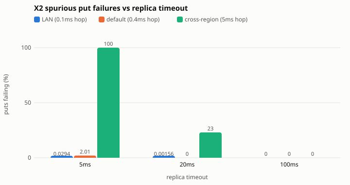

## X3. Periodic anti-entropy: how often?

Before this ablation nothing started anti-entropy; benchmarks called it by hand. Now each node syncs with one random reachable peer every interval. Scenario: A3's sloppy R=1,W=2 writes on both sides of a {n1,n2} | {n3,n4,n5} partition for 1s, hinted handoff off so only anti-entropy repairs, then heal. Time is from heal until the 3 preferred replicas of all 64 keys agree (capped at 8s). Idle cost is measured for 1s after convergence. Mean (min-max) of 3 runs.

| interval | time to converge ms | idle messages/s | idle KB/s |
|---|---|---|---|
| 20ms | 126.2 (104.0-169.2) | 192 | 172.5 |
| 100ms | 403.5 (269.7-472.9) | 37 | 35.6 |
| 500ms | 2302.1 (1459.4-3973.6) | 9 | 7.9 |
| 2s | 5982.5 (2970.2-8005.7) | 3 | 3.6 |

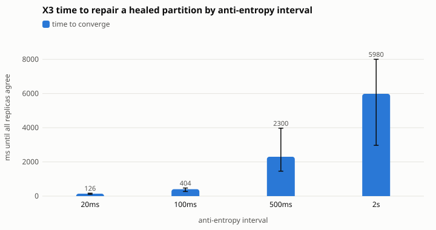
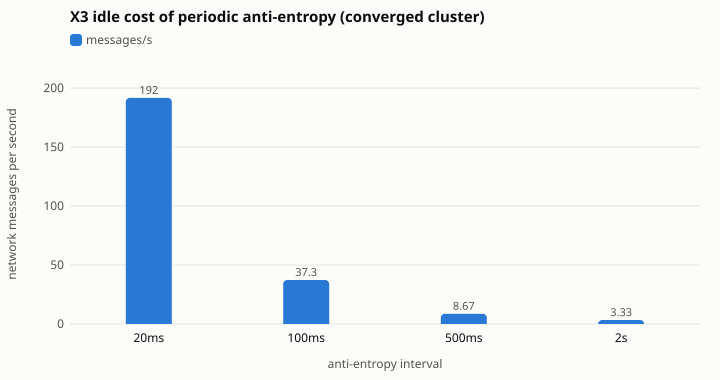

## X4. Cluster size and replication factor

E1 workload. "Majority" is R=W=floor(N/2)+1 (R+W>N). Mean (min-max) of 3 runs.

| nodes | N | R=W=1 stale % | majority quorum | majority stale % | majority get p99 ms | majority put p99 ms |
|---|---|---|---|---|---|---|
| 5 | 2 | 15.2 (15.1-15.3) | 2,2 | 0.0 (0.0-0.0) | 11.7 (11.5-12.1) | 11.7 (11.3-12.2) |
| 5 | 3 | 26.4 (26.2-26.6) | 2,2 | 0.0 (0.0-0.0) | 8.4 (7.9-8.7) | 8.4 (8.1-8.6) |
| 5 | 5 | 23.4 (21.1-24.8) | 3,3 | 0.0 (0.0-0.0) | 7.8 (7.5-8.0) | 7.8 (7.6-8.0) |
| 7 | 3 | 26.4 (26.0-27.0) | 2,2 | 0.0 (0.0-0.0) | 8.6 (8.3-8.8) | 8.5 (8.2-8.9) |

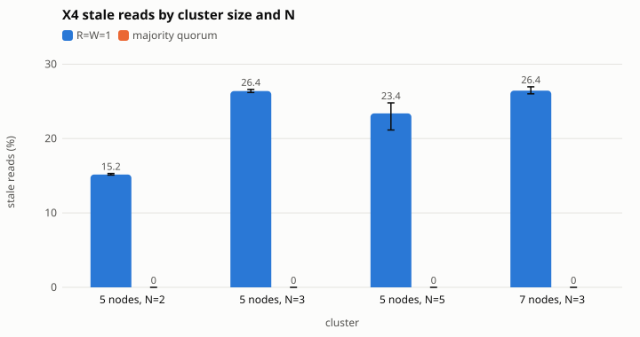

## X5. Workload shape

Stale reads depend on how often a read lands right after a write to the same key. Mean (min-max) of 3 runs.

| workload | R=W=1 stale % | R=1,W=2 stale % |
|---|---|---|
| baseline: 32 keys, 16 readers | 26.5 (26.1-26.9) | 0.3 (0.3-0.3) |
| 8 keys | 17.0 (16.3-17.7) | 0.1 (0.1-0.1) |
| 256 keys | 9.8 (9.2-10.2) | 1.2 (1.1-1.3) |
| 4 readers | 24.5 (23.6-25.6) | 0.4 (0.4-0.4) |
| 64 readers | 14.4 (14.1-14.5) | 0.4 (0.3-0.5) |
| writers pause 2ms (read-heavy) | 12.2 (12.0-12.5) | 0.3 (0.3-0.3) |
| Zipf-skewed reads (hot keys) | 25.1 (24.6-25.5) | 0.2 (0.2-0.2) |

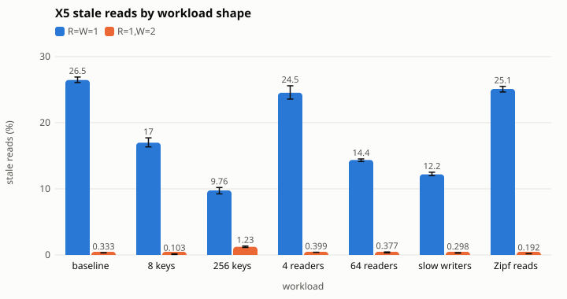

## X6. Hinted-handoff interval

Same partition scenario as X3 (anti-entropy off). After heal, how long until every hint is delivered to its owner. Mean (min-max) of 3 runs.

| interval | time to drain hints ms |
|---|---|
| 1ms | 115.1 (112.4-118.5) |
| 5ms | 115.8 (111.1-124.5) |
| 20ms | 121.9 (120.9-123.8) |
| 100ms | 151.0 (148.5-153.8) |
| 500ms | 562.6 (561.2-564.9) |

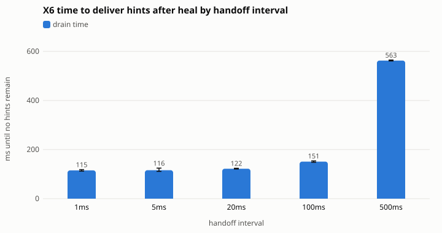

## X7. Read path: read repair and query fan-out

**Read repair cost.** E1 workload, network messages per client operation, read repair on vs off. Mean (min-max) of 3 runs.

| R,W | read repair | messages/op | stale reads % |
|---|---|---|---|
| 1,1 | true | 3.3 (3.3-3.3) | 26.4 (26.4-26.5) |
| 1,1 | false | 3.0 (3.0-3.0) | 26.6 (26.3-26.9) |
| 2,2 | true | 3.2 (3.2-3.2) | 0.0 (0.0-0.0) |
| 2,2 | false | 3.0 (3.0-3.0) | 0.0 (0.0-0.0) |

**Query all N replicas vs only R.** A read normally goes to all N replicas and returns after the first R answers. "R only" asks just R random replicas. With and without a slow replica (n3 +3ms). Mean (min-max) of 3 runs.

| R,W | n3 | query | get p99 ms | get failures % | messages/op |
|---|---|---|---|---|---|
| 1,1 | normal | all N | 5.1 (5.1-5.2) | 0.0 (0.0-0.0) | 3.3 (3.3-3.3) |
| 1,1 | normal | R only | 10.7 (10.6-10.7) | 0.0 (0.0-0.0) | 2.8 (2.8-2.9) |
| 1,1 | slow | all N | 9.8 (9.4-10.4) | 0.0 (0.0-0.0) | 3.2 (3.2-3.2) |
| 1,1 | slow | R only | 20.0 (19.8-20.3) | 0.0 (0.0-0.0) | 2.8 (2.8-2.8) |
| 2,2 | normal | all N | 8.2 (8.0-8.4) | 0.0 (0.0-0.1) | 3.2 (3.2-3.2) |
| 2,2 | normal | R only | 11.8 (11.6-12.2) | 0.0 (0.0-0.0) | 2.9 (2.9-2.9) |
| 2,2 | slow | all N | 18.4 (18.3-18.5) | 0.0 (0.0-0.0) | 3.1 (3.1-3.1) |
| 2,2 | slow | R only | 21.7 (21.7-21.9) | 0.0 (0.0-0.1) | 2.9 (2.9-2.9) |

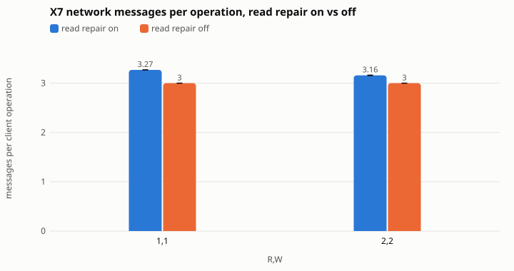
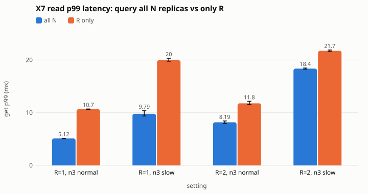

## X8. Failure detector and partition shape

**False suspicions.** Healthy cluster, sloppy quorums, R=W=2. With probability p the coordinator's `Reachable` wrongly reports a live node as down (messages still flow), so it sends to fallback nodes needlessly. Mean (min-max) of 3 runs.

| p | stale reads % | messages/op | hints parked at end | put failures % |
|---|---|---|---|---|
| 0% | 0.0 (0.0-0.0) | 3.2 (3.2-3.2) | 0.0 (0.0-0.0) | 0.0 (0.0-0.0) |
| 5% | 0.0 (0.0-0.0) | 3.3 (3.3-3.3) | 10.3 (9.0-12.0) | 0.0 (0.0-0.0) |
| 20% | 0.2 (0.2-0.2) | 3.4 (3.4-3.4) | 152.7 (149.0-157.0) | 0.0 (0.0-0.0) |

**Partition shapes.** 12 clients spread over the groups, R=W=2, 2s on 64 keys (flapping: split and heal every 200ms). After the end, heal, drain hints, run 2 anti-entropy rounds and check that every acknowledged write is still readable at R=3 and the replicas agree. One run per cell.

| shape | quorum | availability % | acked writes lost | replicas agree |
|---|---|---|---|---|
| 1 vs 4 nodes | strict | 72.8 | 0 | true |
| 1 vs 4 nodes | sloppy | 82.0 | 0 | true |
| 2 vs 3 nodes (E3) | strict | 48.5 | 0 | true |
| 2 vs 3 nodes (E3) | sloppy | 100.0 | 0 | true |
| 2 vs 2 vs 1 nodes | strict | 26.0 | 0 | true |
| 2 vs 2 vs 1 nodes | sloppy | 88.9 | 0 | true |
| 2 vs 3, flapping | strict | 85.7 | 0 | true |
| 2 vs 3, flapping | sloppy | 99.1 | 0 | true |

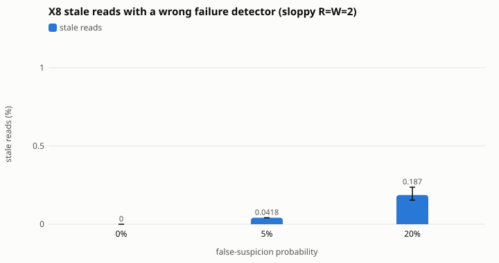
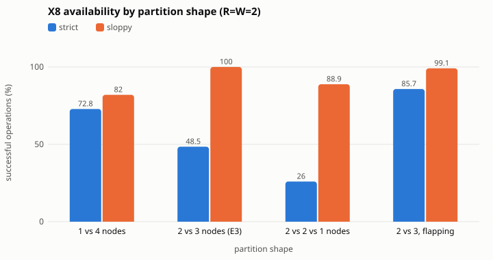
## X9. Sibling and clock growth during a long partition

Cluster split {n1,n2} | {n3,n4,n5}, R=W=1 strict, 8 hot keys, writers split over both sides, 2s of partition, then heal, three anti-entropy rounds, then one client reads and writes back every key under the merged context. Mean (min-max) of 3 runs. "Union" clients read, merge and write back (the intended use); "blind" clients write without reading, so every write is concurrent with every earlier one (the worst case).

| writers | clients | max siblings per key | max clock entries | largest sibling set KB | siblings after heal + anti-entropy | after read-merge-write | keys (of 8) whose R=3 read timed out |
|---|---|---|---|---|---|---|---|
| 2 | union | 1.0 (1.0-1.0) | 3.0 (3.0-3.0) | 0.0 (0.0-0.0) | 2.0 (2.0-2.0) | 1.0 (1.0-1.0) | 0.0 (0.0-0.0) |
| 2 | blind | 217.7 (217.0-219.0) | 1.0 (1.0-1.0) | 6.4 (6.4-6.5) | 346.0 (345.0-348.0) | 1.0 (1.0-1.0) | 4.0 (4.0-4.0) |
| 8 | union | 2.7 (2.0-3.0) | 3.0 (3.0-3.0) | 0.1 (0.1-0.1) | 3.7 (3.0-4.0) | 1.0 (1.0-1.0) | 0.0 (0.0-0.0) |
| 8 | blind | 320.3 (318.0-325.0) | 1.0 (1.0-1.0) | 9.3 (9.3-9.5) | 468.7 (461.0-478.0) | 304.0 (1.0-461.0) | 6.0 (6.0-6.0) |
| 32 | union | 4.0 (3.0-5.0) | 3.0 (3.0-3.0) | 0.3 (0.3-0.4) | 6.0 (6.0-6.0) | 1.0 (1.0-1.0) | 0.0 (0.0-0.0) |
| 32 | blind | 347.0 (343.0-352.0) | 1.0 (1.0-1.0) | 10.2 (10.0-10.3) | 513.0 (505.0-518.0) | 345.0 (1.0-518.0) | 6.0 (6.0-6.0) |

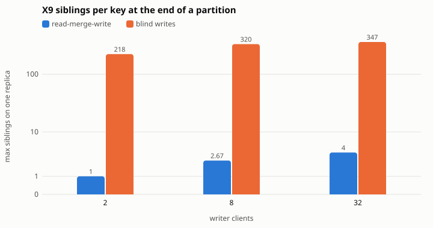
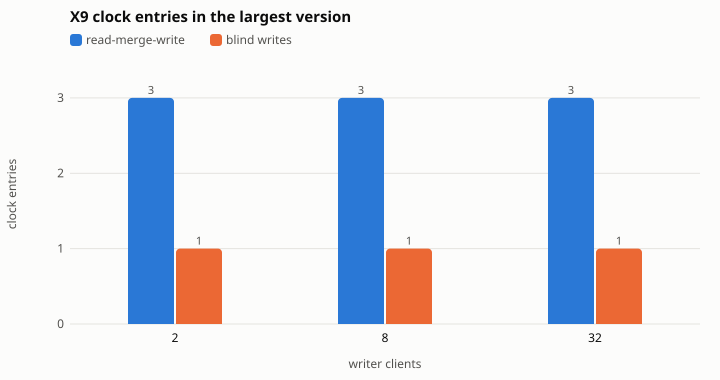
## X10. Clients with different R and W in one run

One cluster, 30 keys. Key k is always written with W = 1 + k mod 3; nine readers use R=1, 2 or 3 (three each), all at the same time. Stale reads % per (key W, reader R) pair, mean (min-max) of 3 runs. The theory says a pair is never stale when R + W > 3; those cells are marked *.

| key written with | R=1 | R=2 | R=3 |
|---|---|---|---|
| W=1 | 13.0 (12.3-13.6) | 0.6 (0.5-0.7) | 0.0 (0.0-0.0) * |
| W=2 | 0.3 (0.2-0.4) | 0.0 (0.0-0.0) * | 0.0 (0.0-0.0) * |
| W=3 | 0.0 (0.0-0.0) * | 0.0 (0.0-0.0) * | 0.0 (0.0-0.0) * |

Largest stale rate among the * cells (R + W > 3): 0.00%.

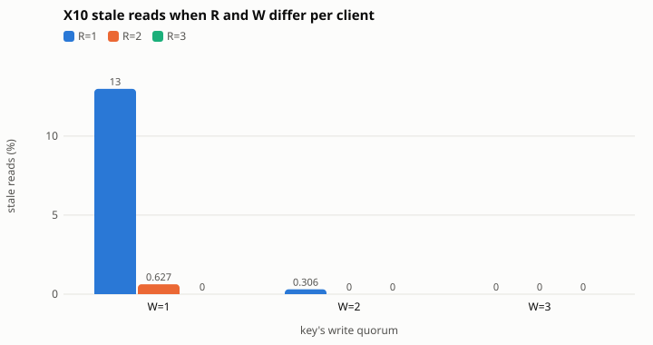

## X11. A node joining a running cluster

4 nodes, 400 static keys written at W=3, then 32 hot keys with a writer each and 8 readers, all R=W=2 strict. After 1s a fifth node joins (`Cluster.AddNode`); it starts empty and fills by anti-entropy. "During" is from the join until the new node holds every static key it should; "after" is the next 1s. Mean (min-max) of 3 runs.

| anti-entropy interval | stale % before | stale % during | stale % after | put failures % during | time until new node is filled (ms) | static copies lost | keys on new node % |
|---|---|---|---|---|---|---|---|
| 20ms | 0.0 (0.0-0.0) | 0.0 (0.0-0.0) | 0.0 (0.0-0.0) | 0.0 (0.0-0.0) | 63.5 (57.5-75.1) | 0.0 (0.0-0.0) | 65.8 (65.8-65.8) |
| 100ms | 0.0 (0.0-0.0) | 0.0 (0.0-0.0) | 0.0 (0.0-0.0) | 0.0 (0.0-0.0) | 219.6 (33.0-392.3) | 0.0 (0.0-0.0) | 65.8 (65.8-65.8) |
| 500ms | 0.0 (0.0-0.0) | 0.0 (0.0-0.0) | 0.0 (0.0-0.0) | 0.0 (0.0-0.0) | 1784.7 (1523.4-2025.6) | 0.0 (0.0-0.0) | 65.7 (65.7-65.8) |

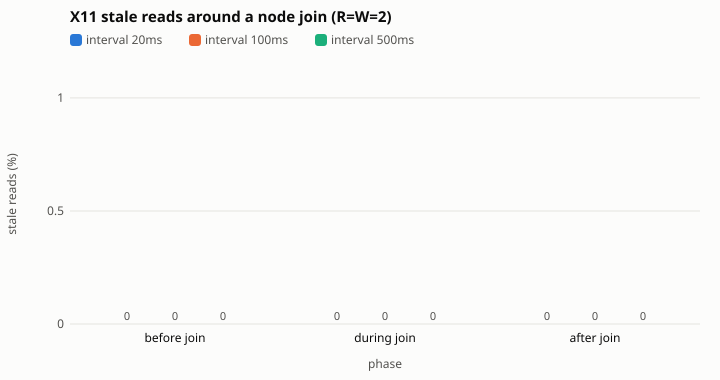
