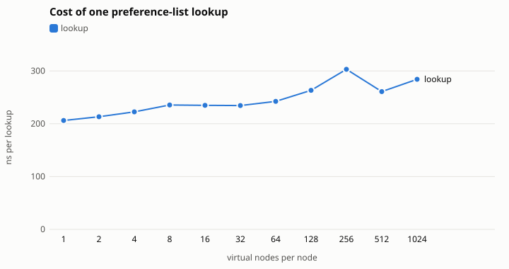
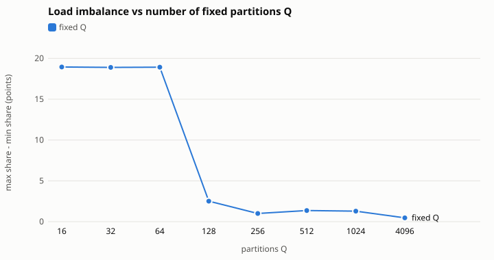
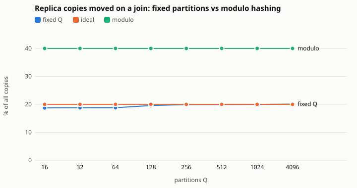
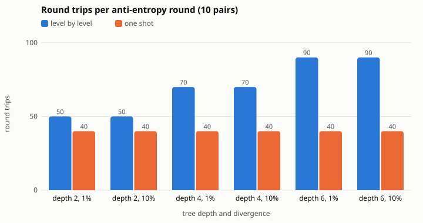
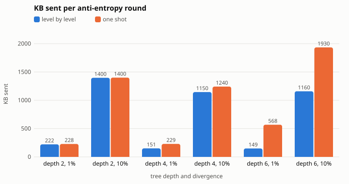

# Architecture experiments

Default cluster unless stated: 5 nodes, N=3, replica-to-replica latency 0.4ms + Exp(0.8ms) with 3% of messages +5ms, client hop 0.1ms + Exp(0.1ms), replica timeout 20ms. Regenerate with `go run ./cmd/archbench`.

## A1. Ring hash function and virtual nodes

100,000 keys, 5 nodes, N=3. Each node would hold 60% of the keys if perfectly balanced. Max/min is the most-loaded node's share over the least-loaded node's share.

| hash | vnodes/node | min share | max share | max/min | coefficient of variation |
|---|---|---|---|---|---|
| FNV-1a | 1 | 10.4% | 93.6% | 8.98 | 0.647 |
| FNV-1a | 8 | 10.4% | 93.6% | 8.98 | 0.647 |
| FNV-1a | 64 | 27.9% | 100.0% | 3.58 | 0.401 |
| FNV-1a | 256 | 32.5% | 89.6% | 2.76 | 0.367 |
| MD5 | 1 | 42.1% | 75.3% | 1.79 | 0.217 |
| MD5 | 8 | 50.0% | 69.1% | 1.38 | 0.116 |
| MD5 | 64 | 56.7% | 66.3% | 1.17 | 0.056 |
| MD5 | 256 | 57.8% | 62.4% | 1.08 | 0.031 |

## A1b. Ablation: how many virtual nodes per node?

MD5 ring, 5 nodes, N=3, 20000 keys, averaged over 20 placements (each placement uses different node names, so tokens land in different places). Spread = most-loaded minus least-loaded node's share of replica copies, in points (ideal 0; every node should hold 60%). Moved = replica copies a node must receive when a 5th node joins a 4-node ring (ideal 20%; leaving is the same pair of rings read backwards). "Worst" is the worst of the 20 placements. Lookup is `PreferenceList` on one core (fastest of 5 runs).

| vnodes/node | tokens | mean CV | mean spread | worst spread | mean moved on join | worst moved | lookup ns | build µs |
|---|---|---|---|---|---|---|---|---|
| 1 | 5 | 0.314 | 48.9 | 92.7 | 21.7% | 31.5% | 206 | 8 |
| 2 | 10 | 0.291 | 48.1 | 84.2 | 22.2% | 30.6% | 213 | 10 |
| 4 | 20 | 0.242 | 40.4 | 73.3 | 20.9% | 30.5% | 223 | 19 |
| 8 | 40 | 0.191 | 31.3 | 52.3 | 20.3% | 25.7% | 236 | 54 |
| 16 | 80 | 0.112 | 18.1 | 36.2 | 20.0% | 24.1% | 235 | 76 |
| 32 | 160 | 0.095 | 15.4 | 29.4 | 19.6% | 22.7% | 234 | 144 |
| 64 | 320 | 0.064 | 10.6 | 22.0 | 19.9% | 23.0% | 242 | 425 |
| 128 | 640 | 0.043 | 7.1 | 13.9 | 20.1% | 21.7% | 263 | 895 |
| 256 | 1280 | 0.035 | 5.9 | 11.5 | 20.0% | 21.4% | 303 | 1330 |
| 512 | 2560 | 0.025 | 4.1 | 6.9 | 20.0% | 20.9% | 261 | 2947 |
| 1024 | 5120 | 0.016 | 2.6 | 4.5 | 20.2% | 20.6% | 284 | 6510 |

## A2. What a coordinator replicates, and how versions are compared

8 clients do concurrent read-modify-write on one key for 2s, adding a unique item each time. "Lost" counts acknowledged items missing after a final union merge. Each row is the sum over 3 runs.

| clocks | replication payload | R,W | acked items | lost items |
|---|---|---|---|---|
| dotted version vector | whole sibling set | 1,1 | 8626 | 0 (0.00%) |
| dotted version vector | whole sibling set | 2,2 | 5703 | 0 (0.00%) |
| dotted version vector | new version only | 1,1 | 8802 | 2 (0.02%) |
| dotted version vector | new version only | 2,2 | 5717 | 3 (0.05%) |
| per-node vector clock | whole sibling set | 1,1 | 11218 | 2253 (20.08%) |
| per-node vector clock | whole sibling set | 2,2 | 5639 | 1473 (26.12%) |

## A3. Repair mechanisms after a partition heals

Sloppy R=1 W=2 writes on both sides of a {n1,n2} | {n3,n4,n5} partition for 1s, then heal. "Under-replicated" means an acknowledged write not yet on all 3 preferred replicas. "Divergent" means the 3 replicas of a key disagree.

| repair after heal | acked writes | under-replicated | divergent keys (of 64) |
|---|---|---|---|
| none | 1119 | 1009 (90.2%) | 54 |
| hinted handoff only | 1128 | 537 (47.6%) | 64 |
| read repair only (one R=3 read per key) | 1138 | 73 (6.4%) | 0 |
| anti-entropy only (one round) | 1121 | 72 (6.4%) | 0 |
| hinted handoff + anti-entropy (default) | 1123 | 0 (0.0%) | 0 |

## A4. Choosing the coordinator

Same workload as E1 (32 keys, one writer each, 16 readers), R=1 W=1, for 2s. Load share is each node's fraction of coordinated requests; perfect balance is 20%.

| coordinator | stale reads | coordinator load share n1..n5 | busiest node |
|---|---|---|---|
| always first preferred replica | 0.1% | 16% / 16% / 22% / 25% / 22% | 25% |
| random preferred replica (default) | 26.5% | 21% / 18% / 18% / 21% / 23% | 23% |

## A5. Replica timeout

How long a coordinator waits for replicas. Strict R=W=2, 64 keys, partition {n1,n2} | {n3,n4,n5}, 6 clients per side, 1s. A failed operation costs the full timeout.

| replica timeout | no partition: put p99 ms | no partition: put failures | partitioned: failed-op latency p50 ms | partitioned: put availability |
|---|---|---|---|---|
| 2ms | 5.57 | 84.38% | 3.63 | 10.7% |
| 5ms | 10.29 | 7.62% | 6.98 | 44.3% |
| 20ms | 13.53 | 0.00% | 22.43 | 48.4% |
| 100ms | 12.66 | 0.00% | 102.61 | 47.5% |

## A6. Anti-entropy: full-state exchange vs Merkle trees

20000 keys, all 3 replicas identical, then a fraction of keys gets a newer version on one replica only. One anti-entropy round (10 node pairs). Traffic is both directions; bytes use a simple size model (key, value, dot, context entries; 8 bytes per hash).

| strategy | divergence | keys sent | KB sent | round trips | time | divergent keys after |
|---|---|---|---|---|---|---|
| full-state | 0% | 120000 | 6966.2 | 10 | 274ms | 0 |
| full-state | 1% | 120000 | 6975.9 | 10 | 285ms | 0 |
| full-state | 10% | 120000 | 7062.4 | 10 | 283ms | 0 |
| Merkle (per partition) | 0% | 0 | 9.0 | 10 | 38ms | 0 |
| Merkle (per partition) | 1% | 832 | 151.0 | 70 | 285ms | 0 |
| Merkle (per partition) | 10% | 8240 | 1145.4 | 70 | 337ms | 0 |

Depth of each partition's tree (leaves = 2^depth) at 1% and 10% divergence:

| depth | divergence | keys sent | hashes sent | KB sent | round trips |
|---|---|---|---|---|---|
| 0 | 1% | 832 | 25772 | 496.4 | 30 |
| 1 | 1% | 832 | 15568 | 320.8 | 40 |
| 2 | 1% | 832 | 9885 | 221.7 | 50 |
| 3 | 1% | 832 | 7049 | 170.8 | 60 |
| 4 | 1% | 832 | 6042 | 151.0 | 70 |
| 5 | 1% | 832 | 5898 | 145.8 | 80 |
| 6 | 1% | 832 | 6262 | 149.2 | 90 |
| 8 | 1% | 832 | 7576 | 166.0 | 110 |
| 0 | 10% | 8240 | 59545 | 1598.7 | 30 |
| 1 | 10% | 8240 | 55970 | 1537.5 | 40 |
| 2 | 10% | 8240 | 47936 | 1397.5 | 50 |
| 3 | 10% | 8240 | 39644 | 1247.7 | 60 |
| 4 | 10% | 8240 | 34554 | 1145.4 | 70 |
| 5 | 10% | 8240 | 34431 | 1122.8 | 80 |
| 6 | 10% | 8240 | 37964 | 1159.3 | 90 |
| 8 | 10% | 8240 | 50467 | 1320.5 | 110 |

## A8. Ring placement: equal spacing vs random vnodes vs fixed partitions

100000 keys, N=3. With 5 nodes each node should hold 60% of the replica copies. Moving a node in or out should ideally move 20% of all copies (the joining node holds 3/5 of one copy-set; the leaving one held the same). Moved = copies a node must receive because it was not in the key's old preference list.

| scheme | min share | max share | CV | keys whose first replica changes on join | copies moved on join 4→5 | copies moved on leave 5→4 |
|---|---|---|---|---|---|---|
| equal spacing, 1 piece per node | 60.0% | 60.0% | 0.000 | 34.9% | 20.0% | 20.0% |
| random vnodes, 8 per node | 50.0% | 69.1% | 0.116 | 19.5% | 22.0% | 22.0% |
| random vnodes, 64 per node (previous default) | 56.7% | 66.3% | 0.056 | 21.0% | 22.1% | 22.1% |
| fixed partitions, Q=256 | 59.8% | 60.8% | 0.006 | 19.9% | 19.9% | 19.9% |

## A9. How many fixed partitions, and why not modulo hashing?

100000 keys, N=3, 5 nodes after a join from 4. Spread = most-loaded minus least-loaded node's share of replica copies, in points (ideal 0). Moved = replica copies that must move on the join (ideal 20%). The modulo baseline puts a key on node hash%N and the next two nodes.

| scheme | partitions per node | spread (pts) | copies moved on join |
|---|---|---|---|
| fixed, Q=16 | 3.2 | 18.9 | 18.7% |
| fixed, Q=32 | 6.4 | 18.9 | 18.8% |
| fixed, Q=64 | 12.8 | 18.9 | 18.8% |
| fixed, Q=128 | 25.6 | 2.5 | 19.6% |
| fixed, Q=256 | 51.2 | 1.0 | 19.9% |
| fixed, Q=512 | 102.4 | 1.4 | 19.9% |
| fixed, Q=1024 | 204.8 | 1.3 | 20.0% |
| fixed, Q=4096 | 819.2 | 0.5 | 20.1% |
| modulo hash | - | 0.2 | 40.0% |

## A10. Merkle walk: one level per round trip vs whole tree at once

A6's setup (20,000 keys, 256 partitions, one round over 10 node pairs). Level-by-level sends only the hashes under subtrees that differ but needs one round trip per level; one-shot sends every hash of a differing partition's tree after the roots.

| depth | divergence | walk | round trips | hashes sent | KB sent | time |
|---|---|---|---|---|---|---|
| 2 | 1% | level by level | 50 | 9885 | 221.7 | 213ms |
| 2 | 1% | one shot | 40 | 10443 | 228.2 | 180ms |
| 2 | 10% | level by level | 50 | 47936 | 1397.5 | 284ms |
| 2 | 10% | one shot | 40 | 48212 | 1400.7 | 249ms |
| 4 | 1% | level by level | 70 | 6042 | 151.0 | 281ms |
| 4 | 1% | one shot | 40 | 12696 | 229.0 | 171ms |
| 4 | 10% | level by level | 70 | 34554 | 1145.4 | 333ms |
| 4 | 10% | one shot | 40 | 42782 | 1241.9 | 220ms |
| 6 | 1% | level by level | 90 | 6262 | 149.2 | 363ms |
| 6 | 1% | one shot | 40 | 41982 | 567.8 | 176ms |
| 6 | 10% | level by level | 90 | 37964 | 1159.3 | 416ms |
| 6 | 10% | one shot | 40 | 104100 | 1934.3 | 214ms |

