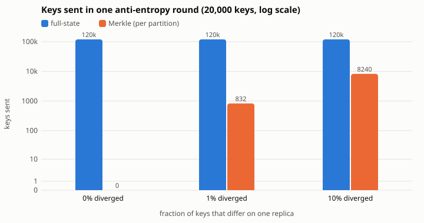
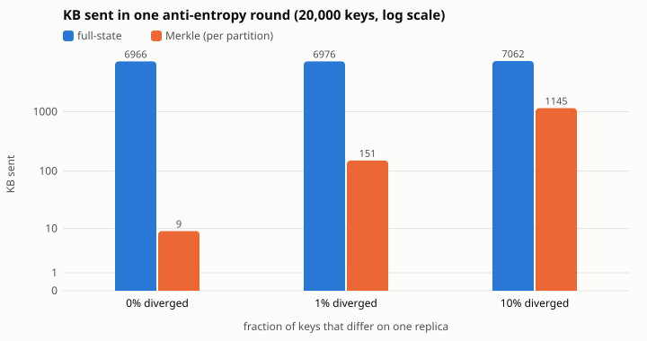
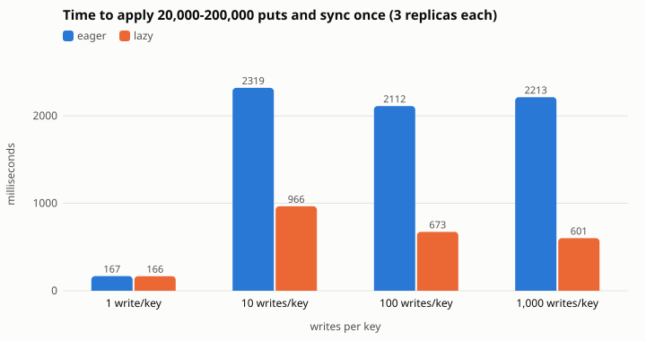
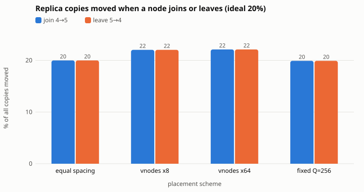

# Architecture experiments

Default cluster unless stated: 5 nodes, N=3, replica-to-replica latency 0.4ms + Exp(0.8ms) with 3% of messages +5ms, client hop 0.1ms + Exp(0.1ms), replica timeout 20ms. Regenerate with `go run ./cmd/archbench`.

## A1. Ring hash function and virtual nodes

100,000 keys, 5 nodes, N=3. Each node would hold 60% of the keys if perfectly balanced. Max/min is the most-loaded node's share over the least-loaded node's share.

| hash | vnodes/node | min share | max share | max/min | coefficient of variation |
|---|---|---|---|---|---|
| FNV-1a | 1 | 10.4% | 93.6% | 8.98 | 0.647 |
| FNV-1a | 8 | 10.4% | 93.6% | 8.98 | 0.647 |
| FNV-1a | 64 | 27.9% | 100.0% | 3.58 | 0.401 |
| FNV-1a | 256 | 32.5% | 89.6% | 2.76 | 0.367 |
| MD5 | 1 | 42.1% | 75.3% | 1.79 | 0.217 |
| MD5 | 8 | 50.0% | 69.1% | 1.38 | 0.116 |
| MD5 | 64 | 56.7% | 66.3% | 1.17 | 0.056 |
| MD5 | 256 | 57.8% | 62.4% | 1.08 | 0.031 |

## A2. What a coordinator replicates, and how versions are compared

8 clients do concurrent read-modify-write on one key for 2s, adding a unique item each time. "Lost" counts acknowledged items missing after a final union merge. Each row is the sum over 3 runs.

| clocks | replication payload | R,W | acked items | lost items |
|---|---|---|---|---|
| dotted version vector | whole sibling set | 1,1 | 8343 | 0 (0.00%) |
| dotted version vector | whole sibling set | 2,2 | 5693 | 0 (0.00%) |
| dotted version vector | new version only | 1,1 | 8281 | 2 (0.02%) |
| dotted version vector | new version only | 2,2 | 5680 | 1 (0.02%) |
| per-node vector clock | whole sibling set | 1,1 | 10848 | 2136 (19.69%) |
| per-node vector clock | whole sibling set | 2,2 | 5663 | 1428 (25.22%) |

## A3. Repair mechanisms after a partition heals

Sloppy R=1 W=2 writes on both sides of a {n1,n2} | {n3,n4,n5} partition for 1s, then heal. "Under-replicated" means an acknowledged write not yet on all 3 preferred replicas. "Divergent" means the 3 replicas of a key disagree.

| repair after heal | acked writes | under-replicated | divergent keys (of 64) |
|---|---|---|---|
| none | 1126 | 1056 (93.8%) | 57 |
| hinted handoff only | 1129 | 535 (47.4%) | 64 |
| read repair only (one R=3 read per key) | 1134 | 59 (5.2%) | 0 |
| anti-entropy only (one round) | 1138 | 58 (5.1%) | 0 |
| hinted handoff + anti-entropy (default) | 1164 | 0 (0.0%) | 0 |

## A4. Choosing the coordinator

Same workload as E1 (32 keys, one writer each, 16 readers), R=1 W=1, for 2s. Load share is each node's fraction of coordinated requests; perfect balance is 20%.

| coordinator | stale reads | coordinator load share n1..n5 | busiest node |
|---|---|---|---|
| always first preferred replica | 0.1% | 22% / 12% / 19% / 31% / 16% | 31% |
| random preferred replica (default) | 25.1% | 19% / 23% / 17% / 20% / 22% | 23% |

## A5. Replica timeout

How long a coordinator waits for replicas. Strict R=W=2, 64 keys, partition {n1,n2} | {n3,n4,n5}, 6 clients per side, 1s. A failed operation costs the full timeout.

| replica timeout | no partition: put p99 ms | no partition: put failures | partitioned: failed-op latency p50 ms | partitioned: put availability |
|---|---|---|---|---|
| 2ms | 5.93 | 81.65% | 3.64 | 10.8% |
| 5ms | 10.75 | 9.44% | 6.81 | 45.6% |
| 20ms | 12.51 | 0.00% | 22.46 | 57.2% |
| 100ms | 12.29 | 0.00% | 102.63 | 60.2% |

## A6. Anti-entropy: full-state exchange vs Merkle trees

20000 keys, all 3 replicas identical, then a fraction of keys gets a newer version on one replica only. One anti-entropy round (10 node pairs). Traffic is both directions; bytes use a simple size model (key, value, dot, context entries; 8 bytes per hash).

| strategy | divergence | keys sent | KB sent | round trips | time | divergent keys after |
|---|---|---|---|---|---|---|
| full-state | 0% | 120000 | 6966.2 | 10 | 413ms | 0 |
| full-state | 1% | 120000 | 6975.8 | 10 | 445ms | 0 |
| full-state | 10% | 120000 | 7061.4 | 10 | 495ms | 0 |
| Merkle (depth 10) | 0% | 0 | 0.1 | 10 | 38ms | 0 |
| Merkle (depth 10) | 1% | 832 | 236.3 | 130 | 510ms | 0 |
| Merkle (depth 10) | 10% | 8240 | 1428.0 | 130 | 604ms | 0 |

Tree depth (leaves = 2^depth) at 1% and 10% divergence:

| depth | divergence | keys sent | hashes sent | KB sent | round trips |
|---|---|---|---|---|---|
| 4 | 1% | 832 | 53355 | 967.7 | 70 |
| 6 | 1% | 832 | 42286 | 778.1 | 90 |
| 8 | 1% | 832 | 25072 | 482.5 | 110 |
| 10 | 1% | 832 | 10876 | 236.3 | 130 |
| 12 | 1% | 832 | 7103 | 166.8 | 150 |
| 14 | 1% | 832 | 7373 | 165.9 | 170 |
| 4 | 10% | 8240 | 60274 | 1610.2 | 70 |
| 6 | 10% | 8240 | 60666 | 1615.9 | 90 |
| 8 | 10% | 8240 | 60069 | 1603.5 | 110 |
| 10 | 10% | 8240 | 50079 | 1428.0 | 130 |
| 12 | 10% | 8240 | 37162 | 1183.1 | 150 |
| 14 | 10% | 8240 | 40695 | 1199.0 | 170 |

## A7. Eager vs lazy Merkle-tree maintenance

Puts applied straight to replica state (3 replicas each), then one anti-entropy round on identical replicas. "Flush" is how much longer the first round took than an immediately repeated one (the lazy trees catching up). Median of 3 runs. Total = puts + flush.

| workload | strategy | puts | per put | flush | total |
|---|---|---|---|---|---|
| each key written once (20,000 keys) | eager | 167ms | 8.35us | 0ms | 167ms |
| each key written once (20,000 keys) | lazy | 48ms | 2.42us | 118ms | 166ms |
| 10 writes per key (20,000 keys) | eager | 2319ms | 11.60us | 0ms | 2319ms |
| 10 writes per key (20,000 keys) | lazy | 814ms | 4.07us | 152ms | 966ms |
| 100 writes per key (2,000 keys) | eager | 2112ms | 10.56us | 0ms | 2112ms |
| 100 writes per key (2,000 keys) | lazy | 656ms | 3.28us | 17ms | 673ms |
| 1,000 writes per key (200 keys) | eager | 2213ms | 11.07us | 0ms | 2213ms |
| 1,000 writes per key (200 keys) | lazy | 599ms | 3.00us | 1ms | 601ms |

## A8. Ring placement: equal spacing vs random vnodes vs fixed partitions

100000 keys, N=3. With 5 nodes each node should hold 60% of the replica copies. Moving a node in or out should ideally move 20% of all copies (the joining node holds 3/5 of one copy-set; the leaving one held the same). Moved = copies a node must receive because it was not in the key's old preference list.

| scheme | min share | max share | CV | keys whose first replica changes on join | copies moved on join 4→5 | copies moved on leave 5→4 |
|---|---|---|---|---|---|---|
| equal spacing, 1 piece per node | 60.0% | 60.0% | 0.000 | 34.9% | 20.0% | 20.0% |
| random vnodes, 8 per node | 50.0% | 69.1% | 0.116 | 19.5% | 22.0% | 22.0% |
| random vnodes, 64 per node (default) | 56.7% | 66.3% | 0.056 | 21.0% | 22.1% | 22.1% |
| fixed partitions, Q=256 | 59.8% | 60.8% | 0.006 | 19.9% | 19.9% | 19.9% |

